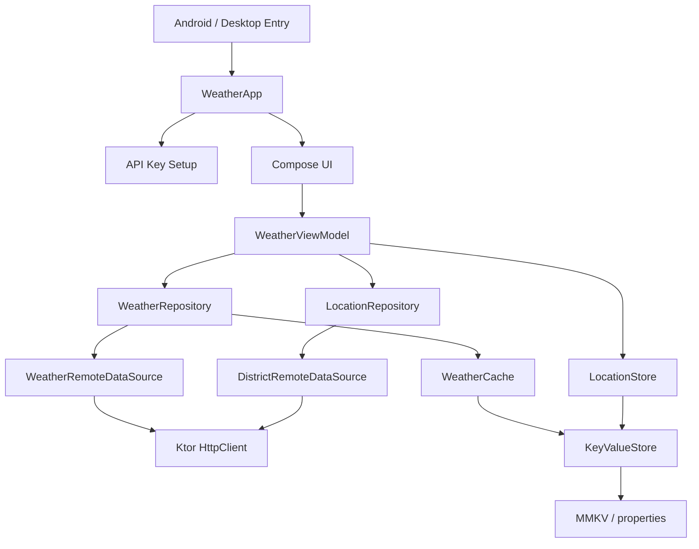

<div align="center">

# Weather

**基于 Kotlin Multiplatform 与 Compose Multiplatform 的多城市天气客户端**

Android 为主要运行平台，同时保留 Desktop（JVM）实验性支持。


</div>

## 项目简介

Weather 是一个用于练习 Android 与 Kotlin Multiplatform 开发的天气客户端。项目采用 MVVM 与分层架构，通过高德开放平台获取实时天气、天气预报和行政区域数据，并使用本地缓存减少重复请求、改善弱网和离线场景下的使用体验。

项目重点不只是展示天气数据，还包括：跨平台代码组织、状态驱动 UI、协程并发、请求错误分类、本地缓存策略，以及可独立运行的共享模块测试。

> English summary: A Kotlin Multiplatform weather client built with Compose Multiplatform, Ktor, coroutines and a cross-platform key-value storage abstraction. Android is the primary target; Desktop/JVM support is experimental.

## 功能特性

- 展示当前天气及未来多日天气预报；
- 按省 / 市 / 区逐级选择地点；
- 支持中文、完整拼音和拼音首字母搜索城市；
- 记录当前地点、最近使用地点和收藏地点；
- 支持下拉刷新和显式强制网络刷新；
- 按“城市 + 日期”缓存天气，同一地点当天避免重复请求；
- 网络或 HTTP 异常时回退至最近一次成功缓存；
- 恢复地点选择路径、搜索内容及列表滚动位置；
- 首次启动引导配置高德 Web 服务 API Key，源码中不内置私人 Key；
- Android 使用 MMKV，Desktop 使用本地 properties 文件完成持久化。

## 技术栈

| 领域 | 实现 |
| --- | --- |
| 语言与跨平台 | Kotlin、Kotlin Multiplatform |
| UI | Compose Multiplatform、Material 3 |
| 架构 | MVVM、Repository、分层模型 |
| 状态与异步 | ViewModel、StateFlow、Kotlin Coroutines |
| 网络 | Ktor Client、ContentNegotiation、kotlinx.serialization |
| 本地存储 | KeyValueStore 抽象、MMKV（Android）、properties（Desktop） |
| 测试 | kotlin.test、kotlinx-coroutines-test、Ktor MockEngine |
| 数据来源 | 高德开放平台天气与行政区域 API |

## 架构设计



主要模块职责：

```text
weather/
├─ androidApp/                  # Android 入口、Application 与资源
├─ desktopApp/                  # Desktop/JVM 实验性入口
└─ shared/
   └─ src/
      ├─ commonMain/
      │  ├─ app/                # 应用装配、API Key 配置与依赖生命周期
      │  ├─ core/network/       # 共享 Ktor HttpClient 配置
      │  ├─ core/storage/       # 跨平台键值存储抽象
      │  ├─ feature/location/   # 行政区域、地点搜索与地点持久化
      │  └─ feature/weather/    # 天气 UI、领域模型、远程数据与缓存
      ├─ androidMain/           # Android 平台实现（MMKV、拼音搜索等）
      ├─ jvmMain/               # Desktop/JVM 平台实现
      └─ commonTest/            # ViewModel、Repository、网络与存储测试
```

## 关键实现

### 状态驱动 UI

`WeatherViewModel` 使用 `StateFlow` 暴露天气内容、刷新状态、当前地点和地点选择器状态。Compose UI 只根据状态渲染，业务请求、地点切换和错误映射集中在 ViewModel 与数据层中。

快速切换地点时，ViewModel 会取消旧请求并使用请求序列校验结果，避免较早发起的请求晚返回后覆盖当前页面。

### 天气缓存与离线回退

1. 普通请求优先读取“城市 + 当天”缓存；
2. 未命中时并发请求实时天气和未来天气；
3. 成功后写入当天缓存，并维护该城市最近一次成功快照；
4. `forceRefresh` 跳过当天缓存，明确消耗远程 API 配额；
5. 网络或 HTTP 异常时尝试返回最近一次成功数据；
6. API 业务拒绝、字段缺失和响应格式异常会直接暴露，避免旧缓存掩盖配置或协议问题。

### 跨平台存储

`commonMain` 仅依赖一个精简的 `KeyValueStore` 接口：

```kotlin
interface KeyValueStore {
    fun getString(key: String): String?
    fun putString(key: String, value: String)
}
```

Android 平台通过 `MMKV` 实现，Desktop/JVM 使用本地 properties 文件，测试环境使用内存实现。共享业务代码不直接依赖具体存储引擎。

### 可测试性

- ViewModel 测试使用 Fake Repository 和测试调度器验证状态变化；
- Repository 测试覆盖当天缓存、强制刷新、跨日请求和离线回退；
- RemoteDataSource 测试使用 Ktor `MockEngine` 验证请求参数、JSON 解析和错误映射；
- Storage 测试使用内存 KeyValueStore，避免依赖真实 MMKV 或文件系统。

## 快速开始

### 环境要求

- JDK 11 或更高版本；
- Android Studio（用于 Android 构建与运行）；
- Android SDK 37；
- Android 设备或模拟器最低 API 28。

### 获取项目

```bash
git clone https://github.com/krkrdkdk-star/weather.git
cd weather
```

Windows 环境请将下文的 `./gradlew` 替换为 `gradlew.bat`。

### 配置高德 API Key

项目不会从环境变量或 Gradle 属性读取私人 Key，也不会在源码和构建产物中内置默认 Key。

1. 前往[高德开放平台控制台](https://console.amap.com/dev/key/app)创建应用；
2. 创建 **Web 服务** 类型的 Key；
3. 启动应用，在首次配置页面中输入 Key；
4. 后续可通过天气页面顶部的 `API Key` 入口修改。

> 客户端本地保存的 Key 不能被视为真正的秘密。生产环境应结合服务商侧配额与白名单限制，或通过后端代理完成鉴权和限流。请勿将个人 Key 提交到 Git。

### 运行 Android 版本

```bash
./gradlew :androidApp:assembleDebug
```

也可以直接通过 Android Studio 运行 `androidApp`。

### 运行 Desktop 实验版本

```bash
./gradlew :desktopApp:run
```

使用 Compose Hot Reload：

```bash
./gradlew :desktopApp:hotRun --auto
```

## 测试与验证

运行共享 JVM 测试：

```bash
./gradlew :shared:jvmTest
```

执行共享模块构建及平台验证：

```bash
./gradlew :shared:jvmTest :shared:assemble
./gradlew :androidApp:assembleDebug :desktopApp:classes
```

当前测试覆盖以下核心行为：

- ViewModel 加载、刷新、错误与地点选择状态；
- 中文、全拼和拼音首字母搜索；
- Repository DTO 映射、缓存命中、强制刷新和离线回退；
- Ktor 请求参数、正常响应、HTTP错误、业务错误和非法JSON；
- API Key、当前地点、最近地点及收藏地点的存储行为。

## 项目定位

这是一个个人学习与工程实践项目，重点是展示 Kotlin Multiplatform、Compose、Ktor、协程状态管理、本地缓存与测试的组合使用。Android 为主要目标平台，Desktop/JVM 支持仍属于实验性质。

欢迎通过 Issue 提交问题或建议。
